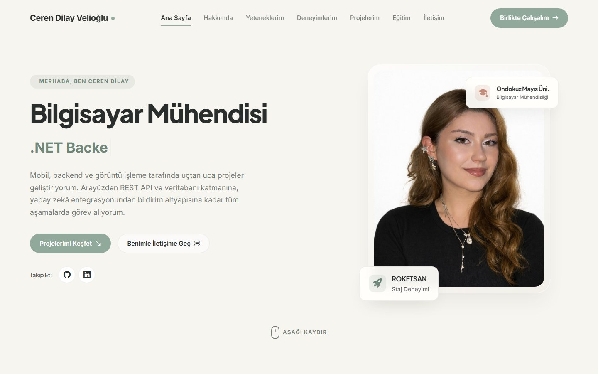
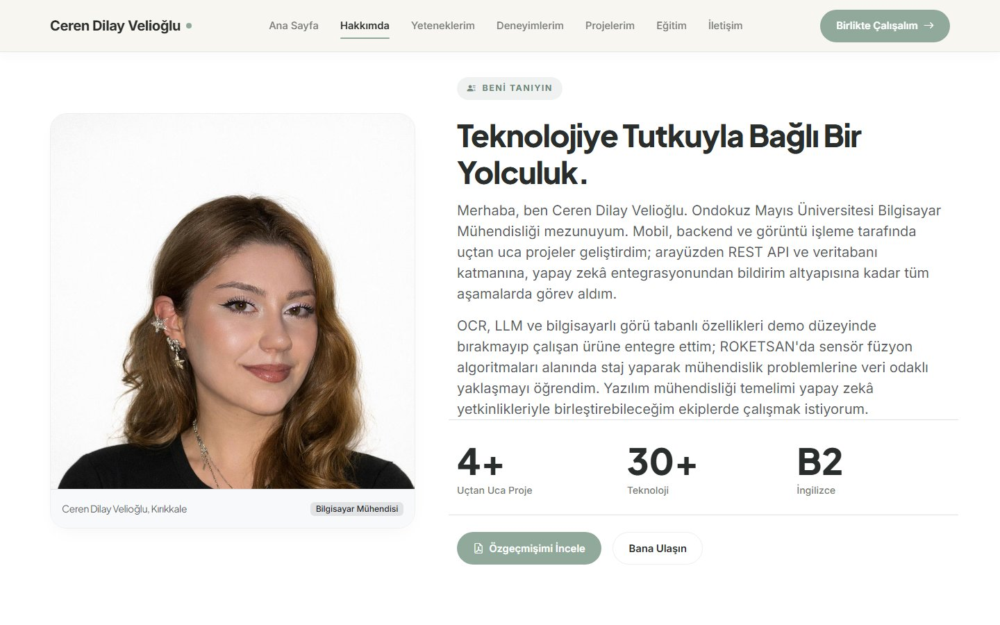
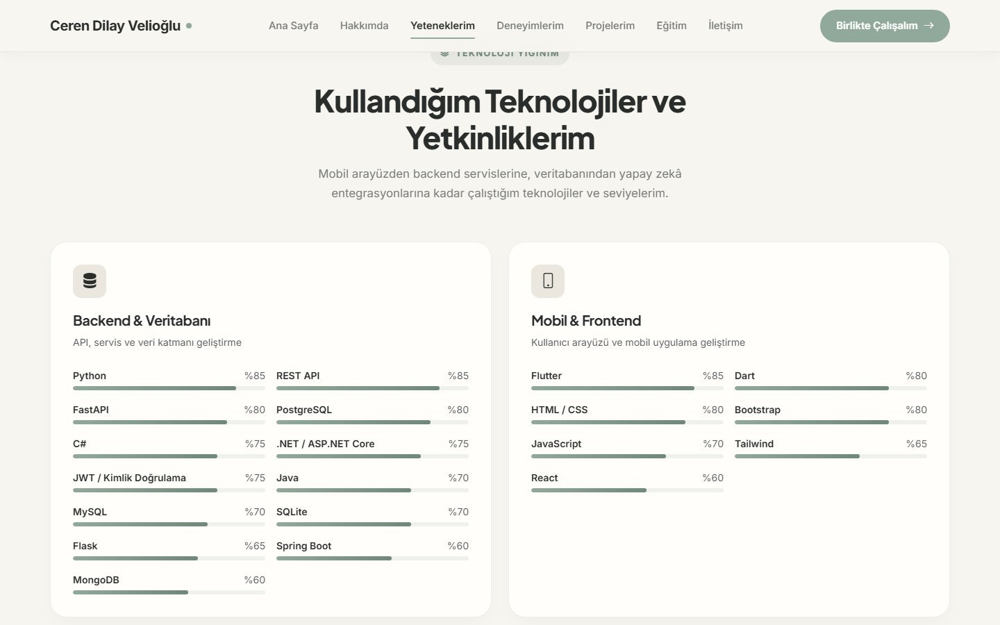
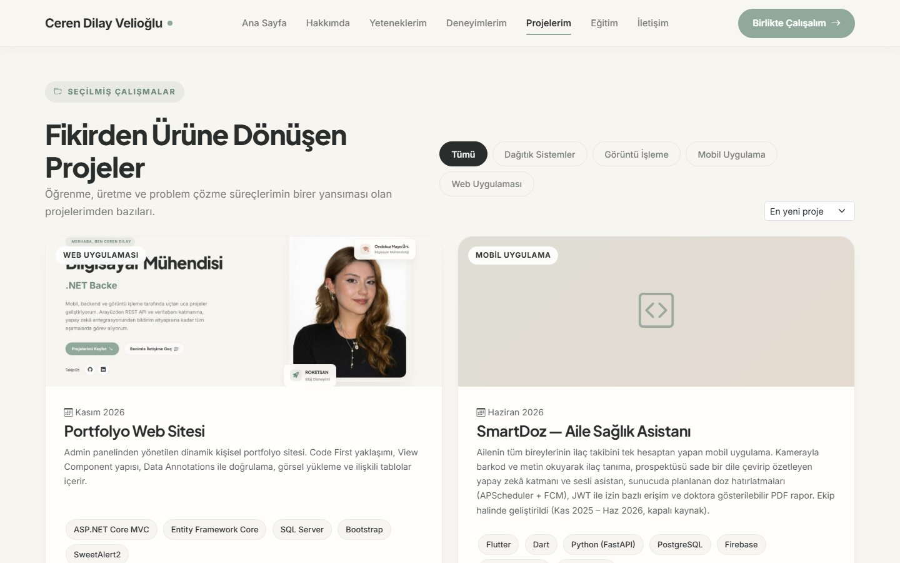
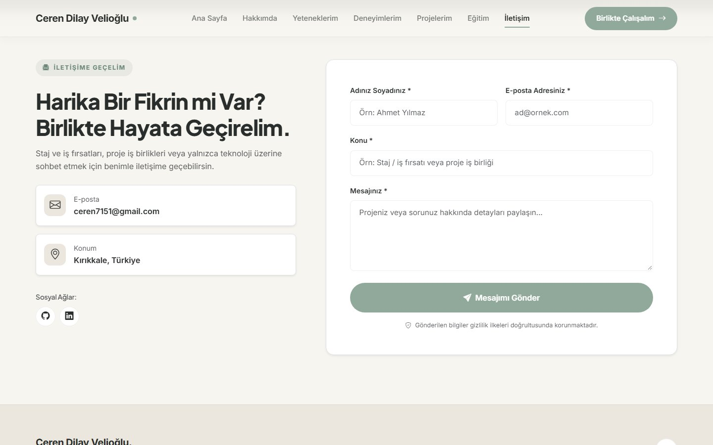
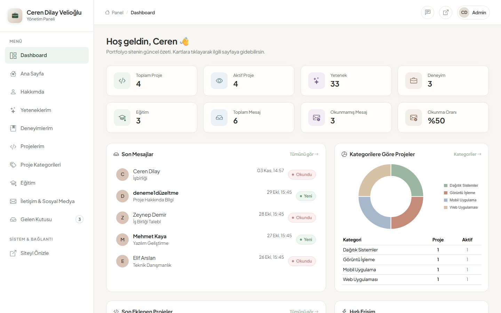
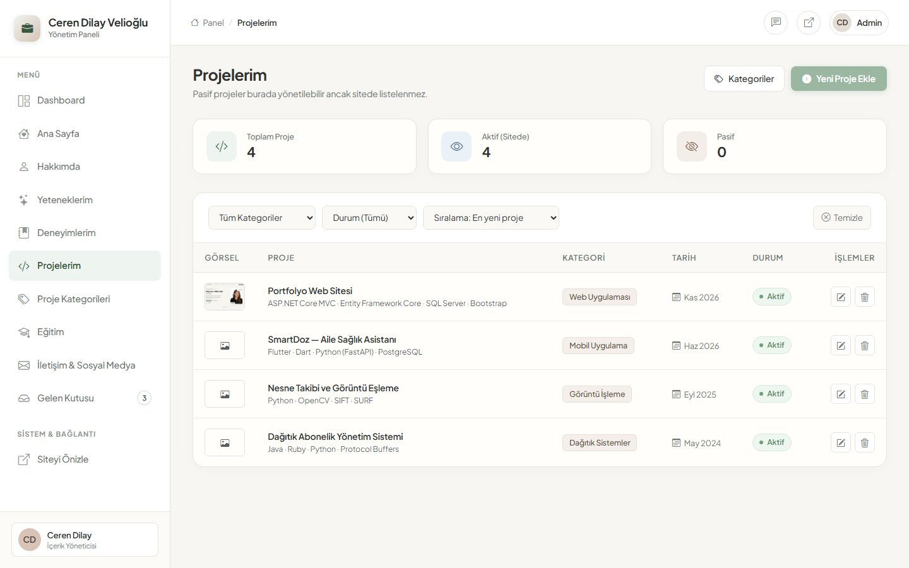
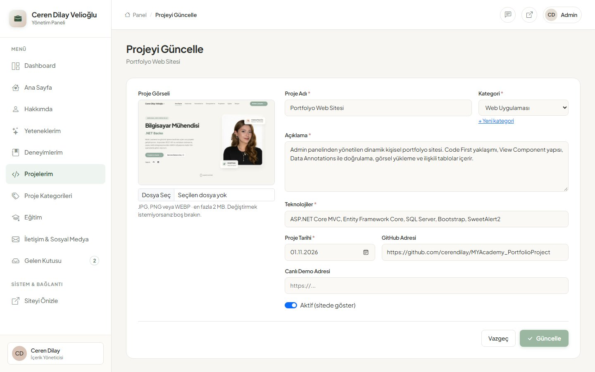
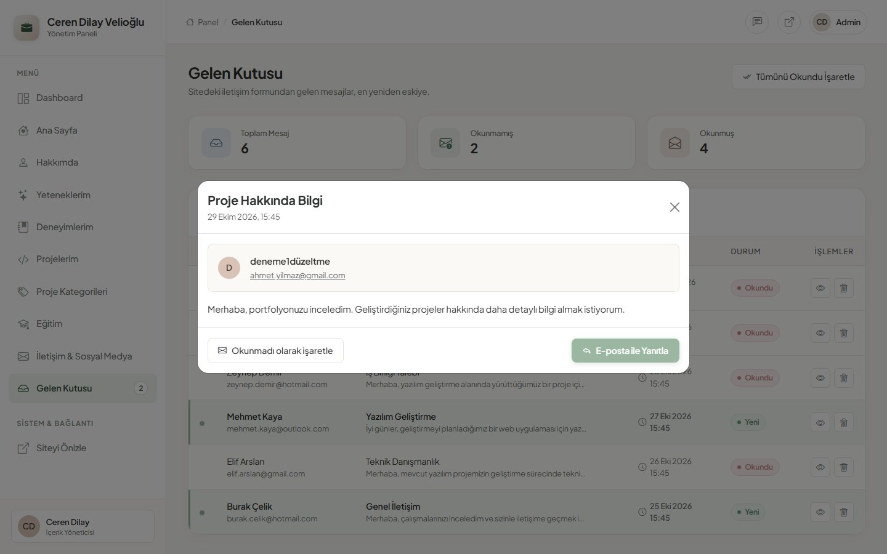
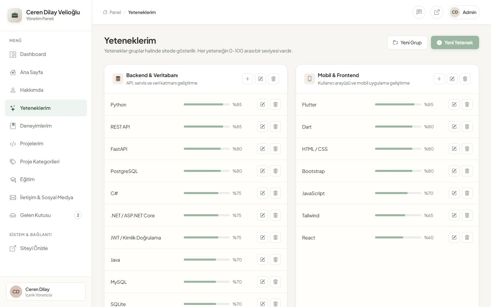

# Portfolyo Projesi — Ceren Dilay Velioğlu

Admin panelinden yönetilen, tamamen dinamik kişisel portfolyo sitesi.
**M&Y Yazılım Eğitim Akademi · 12. Dönem Gündüz Grubu · 1. Proje (Portfolyo Case)**

**Teknolojiler:** ASP.NET Core MVC (.NET 10) · Entity Framework Core (Code First) · SQL Server · Bootstrap 5 · SweetAlert2 · Chart.js

---

## İçindekiler

- [Ekran Görüntüleri](#ekran-görüntüleri)
- [Kurulum](#kurulum)
- [Modüller](#modüller)
- [Yapılan Geliştirmeler](#yapılan-geliştirmeler)
- [Özgün Katkılar](#özgün-katkılar)
- [Proje Yapısı](#proje-yapısı)
- [Bilinen Sınırlamalar](#bilinen-sınırlamalar)

---

## Ekran Görüntüleri

### Site

| Ana Sayfa | Hakkımda |
|---|---|
|  |  |
| **Yetenekler (seviye çubukları)** | **Projeler (kategori filtresi ve sıralama)** |
|  |  |

**İletişim formu**



### Admin Paneli

| Dashboard | Projeler |
|---|---|
|  |  |
| **Proje formu (görsel yükleme, kategori dropdown)** | **Gelen kutusu — mesaj detay modalı** |
|  |  |

**Yetenekler (gruplar ve 0-100 seviye)**



---

## Kurulum

**Gereksinimler:** .NET 10 SDK, SQL Server (Express veya LocalDB de olur), isteğe bağlı Visual Studio 2022+.

```bash
# 1. Depoyu klonlayın
git clone https://github.com/cerendilay/MYAcademy_PortfolioProject.git
cd MYAcademy_PortfolioProject

# 2. Bağlantı dizesini kendi SQL Server'ınıza göre düzenleyin
#    MYAcademy_PortfolioProject/appsettings.json → ConnectionStrings:DefaultConnection

# 3. Veritabanını oluşturun (dotnet-ef aracı depoda yerel araç olarak tanımlı)
dotnet tool restore
dotnet ef database update --project MYAcademy_PortfolioProject

# 4. Çalıştırın
dotnet run --project MYAcademy_PortfolioProject
```

Visual Studio kullanıyorsanız 3. adım yerine *Package Manager Console* üzerinden `Update-Database` komutunu çalıştırabilirsiniz.

| Alan | Adres |
|---|---|
| Site | `http://localhost:5062/` |
| Admin paneli | `http://localhost:5062/Admin` |

Veritabanı boş oluşur. Önerilen içerik giriş sırası: **Ana Sayfa → Hakkımda → İletişim & Sosyal Medya → Proje Kategorileri → Projeler → Yetenekler → Deneyimler → Eğitim**.

> Yüklenen görseller `wwwroot/uploads/` klasörüne kaydedilir. Proje görselleri (`uploads/projects`) depoya dahildir; profil fotoğrafı (`uploads/about`) dahil değildir.

---

## Modüller

| Modül | Admin panelinde | Sitede |
|---|---|---|
| **Ana Sayfa** | Karşılama metinleri; daktilo efektinde dönen unvanlar (ekle / gizle / sil) | Karşılama alanı ve daktilo animasyonu |
| **Hakkımda** | Tek kayıt, güncelleme odaklı: isim, unvan, konum, tanıtım metni, 3 öne çıkan bilgi, fotoğraf yükleme | "Beni Tanıyın" bölümü, karşılama fotoğrafı |
| **Yeteneklerim** | Yetenek grupları ve yetenekler (CRUD), 0-100 seviye kaydırıcısı, grup seçimi dropdown | Grup kartları ve seviye çubukları |
| **Deneyimlerim** | CRUD, tarih aralığı, sıra, tek tıkla Aktif/Pasif, anlık arama | Zaman çizelgesi (yalnızca aktifler) |
| **Eğitim** | CRUD, devam eden eğitim için boş bitiş yılı, sıra, Aktif/Pasif | "Eğitim Hayatım" bölümü |
| **Projelerim** | CRUD, kategori dropdown, görsel yükleme, teknolojiler, GitHub/demo linkleri, Aktif/Pasif, filtre ve sıralama | Kategori filtre butonları ve sıralama; pasif projeler gizli |
| **Proje Kategorileri** | CRUD, kategori başına proje sayısı | Filtre butonları |
| **İletişim & Sosyal Medya** | İletişim bilgisi güncelleme, sosyal bağlantılar (CRUD, ikon önizlemeli) | İletişim bölümü; karşılama, iletişim ve footer'daki sosyal linkler |
| **Gelen Kutusu** | Arama, okundu filtresi, modal detay, okundu/okunmadı, tümünü okundu yap, silme | Çalışan iletişim formu |
| **Dashboard** | İstatistik kartları, son mesajlar, kategori özeti (grafik), son projeler, hızlı erişim | — |

---

## Yapılan Geliştirmeler

### İlişkili tablolar ve doğrulama
- **Category – Project** ve **Skill – SkillItem** bire-çok ilişkileri (Foreign Key + Navigation Property).
- Proje ve yetenek formlarında seçenekler veritabanından `SelectList` + `asp-items` ile gelir; listelerde ilişkili ad `Include` ile gösterilir.
- Tüm entity'lerde `[Required]`, `[StringLength]`, `[Range]`, `[EmailAddress]`, `[Url]`, `[Phone]` kuralları ve Türkçe hata mesajları.
- Sunucu tarafında `ModelState.IsValid` kontrolü; Data Annotations ile yapılamayan kurallar `ModelState.AddModelError` ile eklendi (ör. bitiş yılı başlangıçtan önce olamaz, aynı isimde ikinci kategori eklenemez).

### Görsel yükleme (`Services/ImageUploadService.cs`)
- `IFormFile` ile yükleme; yalnızca JPG / PNG / WEBP, en fazla 2 MB.
- Uzantının yanında dosyanın ilk baytları (dosya imzası) da kontrol edilir; uzantısı değiştirilmiş dosyalar reddedilir.
- Dosya adı `Guid` ile üretilir, veritabanında yalnızca dosya yolu tutulur.
- Görsel değiştirildiğinde veya kayıt silindiğinde eski dosya diskten silinir.

### Gelen kutusu
- Sitedeki form `fetch` ile gönderilir, sayfa yenilenmez; hem istemci hem sunucu doğrulaması vardır ve hata mesajları ilgili alanın altında gösterilir.
- Mesajlar en yeniden eskiye listelenir; gönderen, e-posta veya konuya göre aranır.
- Detay Bootstrap Modal'da açılır; açılan mesaj otomatik "okundu" olur. Okunmamış satırlar görsel olarak ayrılır, sayı sidebar'da ve Dashboard'da görünür.
- Mesaj içeriği düzenlenmez, yalnızca durumu yönetilir.

### Dashboard
`DashboardViewModel` ile farklı tablolardan gelen veriler tek ekranda toplanır. Sorgularda `Count`, `Where`, `OrderByDescending`, `Take`, `GroupBy` ve `Include` kullanıldı. Kategori özeti Chart.js halka grafiğiyle gösterilir.

### Kullanıcı deneyimi ve kod kalitesi
- Silme işlemlerinde SweetAlert2 onayı; işlem sonrası başarı/hata bildirimi (`TempData` + toast).
- Ekleme ve güncelleme sayfaları ortak form partial'larını kullanır (`_ProjectForm`, `_EducationForm` …).
- Silme ve durum değiştirme işlemleri `POST` + antiforgery token ile yapılır.
- Şablondaki sabit içerik ve çalışmayan butonlar veritabanına bağlandı; kullanılmayan varsayılan şablon sayfaları kaldırıldı.
- Bağlantı dizesi koddan `appsettings.json`'a taşındı.

---

## Özgün Katkılar

> *Bu bölümü kendi cümlelerinizle güncelleyin — sunumda neyi neden yaptığınızı anlatacaksınız.*

1. **Tek tıkla Aktif/Pasif:** Deneyim ve proje listelerinde durum rozetine tıklamak kaydı sitede gösterir/gizler; düzenleme sayfasına girmeye gerek kalmaz.
2. **Dashboard'dan mesaja doğrudan erişim:** Son mesajlardan birine tıklanınca gelen kutusu açılır ve o mesajın modalı otomatik açılır; sidebar'daki okunmamış sayısı sayfa yenilenmeden güncellenir.
3. **İletişim formu güvenliği:** Antiforgery token, `[Bind]` ile overposting koruması (dışarıdan `IsRead`/`SendDate` gönderilemez) ve görünmez "bal küpü" alanıyla basit bot koruması.
4. **Veri bütünlüğü:** İçinde proje olan kategori silinemez (aksi halde cascade delete projeleri de silerdi); kullanıcı uyarılır.
5. **Fotoğraf yoksa yer tutucu:** Hakkımda fotoğrafı yüklenmemişse şablon görseli yerine isimden üretilen baş harfler gösterilir.

---

## Proje Yapısı

```
MYAcademy_PortfolioProject/
├── Areas/Admin/
│   ├── Controllers/        # Admin CRUD controller'ları
│   ├── Models/             # DashboardViewModel
│   ├── ViewComponents/     # Admin layout parçaları (sidebar, navbar…)
│   └── Views/              # Admin sayfaları ve ortak form partial'ları
├── Context/                # PortfolioContext (EF Core)
├── Controllers/            # DefaultController (site + iletişim formu)
├── Entities/               # Tablolar (Data Annotations ile)
├── Migrations/             # Code First migration'ları
├── Services/               # ImageUploadService
├── ViewComponents/         # Sitenin bölümleri (hero, hakkımda, projeler…)
├── Views/
└── wwwroot/                # Statik dosyalar, CV, yüklenen görseller
```

---

## Bilinen Sınırlamalar

- Admin paneline giriş / yetkilendirme yoktur (case kapsamında istenmedi). Yayına alınmadan önce eklenmelidir.
- Veritabanı boş oluştuğu için depoyu klonlayan kişi içerikleri (ve profil fotoğrafını) admin panelinden kendisi girmelidir.
